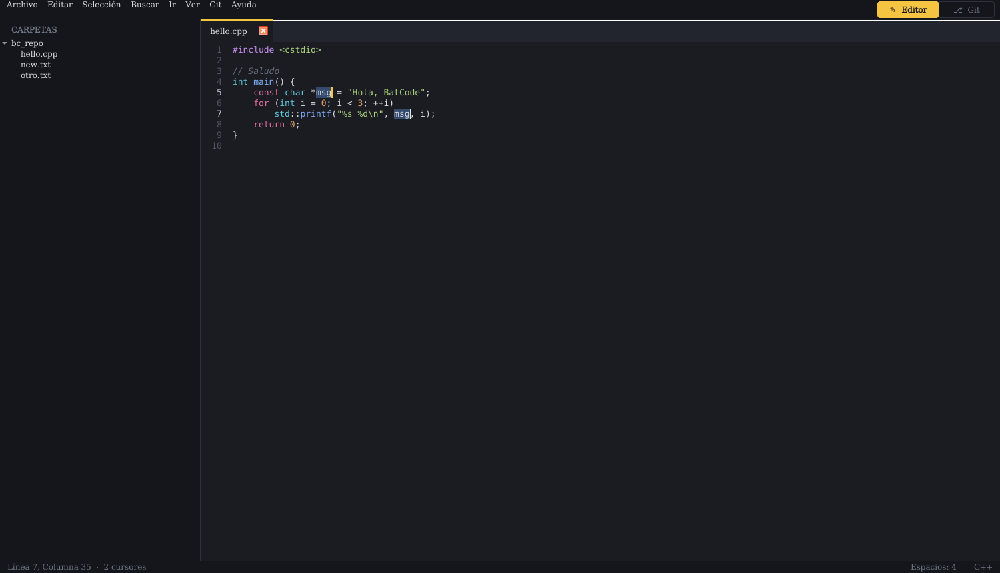
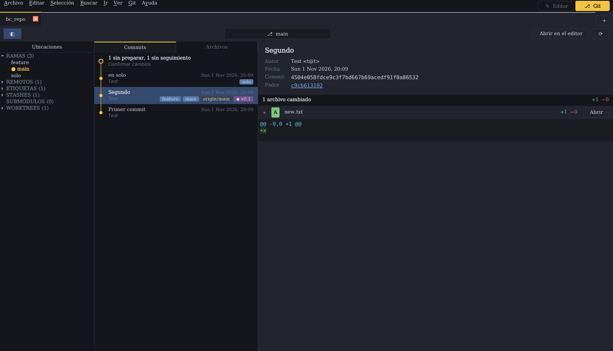

# 🦇 BatCode

Editor de texto en **C++17 + Qt 6** con **Git integrado (libgit2)**, para **Windows y Linux**.
Junta en una sola ventana lo que normalmente se hace con un editor de código y un cliente Git:
editar con cursores múltiples y, en el modo Git, revisar el historial y los diffs, preparar archivos y hacer commits.

> Todo el código es original. Las ideas de interfaz se tomaron del uso habitual de editores
> modernos, sin código ni recursos de ninguna otra aplicación.

BatCode tiene **dos modos**. Se cambia de uno a otro con el interruptor **[ ✎ Editor | ⎇ Git ]**
de la esquina superior derecha, o con `Ctrl+Shift+E` y `Ctrl+Shift+G`.

| Modo editor | Modo Git |
|---|---|
|  |  |

## Idioma y preferencias

BatCode está disponible en **inglés** (idioma por defecto) y **español**. El idioma se cambia en
**File › Preferences…** (**Archivo › Preferencias…**, `Ctrl+,`). BatCode ofrece reiniciarse al
momento y conserva las carpetas, los archivos y los repositorios abiertos. Con el idioma también
cambian el formato de las fechas y, en español, los botones de los diálogos de Qt
(Aceptar/Cancelar/Guardar) y el menú de clic derecho del editor.

La ventana de Preferencias también permite elegir:

| Sección | Opción |
|---|---|
| General | Idioma: English / Español |
| Editor | Tamaño de fuente, sangría (espacios), ajuste de línea y números de línea |
| Git | La opción que ejecutan los botones Pull (`pull`, `--ff-only`, `--rebase`, `--rebase --autostash`) y Push (`push`, `--follow-tags`) |

**Cómo se traduce.** Los textos del código están en español (`tr("…")`), y la traducción al
inglés está compilada dentro del programa (`src/I18nTable.cpp`), así que no hacen falta archivos
`.qm` ni Qt Linguist. Si añades o cambias textos, ejecuta
`python tools/i18n/update_translations.py`: regenera la tabla y lista los textos que aún no tienen
traducción, que se añaden en `tools/i18n/translations_en.py`.

## Modo editor

Tiene dos partes: el **explorador de carpetas** a la izquierda (la carpeta abierta aparece como
nodo raíz bajo «CARPETAS»; se oculta y se muestra con `Ctrl+B`) y las **pestañas** con los
archivos abiertos.

- Pestañas que se pueden mover y cerrar, con el indicador ● de cambios sin guardar. Doble clic en
  la barra vacía crea un archivo nuevo.
- Resaltado de sintaxis: C/C++, C#, Python, JavaScript/TypeScript, Rust, Go, JSON, CMake,
  Shell, YAML/TOML/INI, SQL, HTML/XML y Markdown.
- **Cursores múltiples**:
  - `Ctrl+Clic`: añade o quita un cursor
  - `Ctrl+D`: selecciona la palabra o añade la siguiente coincidencia
  - `Alt+F3`: selecciona todas las coincidencias
  - `Ctrl+Shift+L`: divide la selección en líneas
  - `Ctrl+Alt+↑/↓`: añade un cursor arriba o abajo
  - `Esc`: vuelve a un solo cursor
  - Copiar y pegar por cursor: si pegas N líneas con N cursores, cada uno recibe la suya.
- Autoindentación, `Tab`/`Shift+Tab` por bloques y retroceso inteligente dentro de la sangría.
- `Ctrl+/` comenta o descomenta, `Ctrl+Shift+D` duplica líneas.
- Buscar y reemplazar (`Ctrl+F` / `Ctrl+H`) con texto o regex, mayúsculas y palabra completa.
  En el reemplazo puedes usar grupos (`\1`). Con `Alt+Enter` pones un cursor en cada coincidencia.
- **Buscar en archivos** (`Ctrl+Shift+F`), como en Sublime Text:
  - Campos **Buscar**, **Donde** y **Reemplazar**, con historial.
  - Botones de opción: expresión regular (`.*`), mayúsculas (`Aa`), palabra completa,
    mostrar contexto, resultados en pestaña nueva, respetar `.gitignore` y conservar
    mayúsculas al reemplazar (`AB`).
  - **Donde** acepta una lista separada por comas: carpetas, archivos, filtros (`*.cpp`),
    exclusiones (`-*.log`, `-build`), `<open folders>` y `<open files>`. Vacío = carpetas
    abiertas (o archivos abiertos si no hay carpetas). El botón `…` ayuda a rellenarlo.
  - Los resultados se listan en una pestaña de solo lectura (`Buscando "x" en N archivos`),
    agrupados por archivo con número de línea, coincidencias resaltadas y líneas de contexto.
    **Doble clic** o **Enter** sobre una línea abre el archivo en esa línea con la coincidencia
    seleccionada; `F4` / `Shift+F4` saltan al resultado siguiente / anterior.
  - Se buscan también los cambios sin guardar de las pestañas abiertas; se omiten archivos
    binarios y la carpeta `.git`.
  - **Reemplazar** pide confirmación: en las pestañas abiertas el cambio se hace en el editor
    (se puede deshacer) y el resto de archivos se guarda en disco conservando CRLF/LF y BOM.
- `Ctrl+P`: ir a archivo con búsqueda difusa. `Ctrl+G`: ir a línea.
- Barra de estado con línea y columna, número de cursores, sangría y lenguaje.
- Respeta los finales de línea CRLF/LF de cada archivo y guarda de forma atómica.

**Fuente:** se usan las mismas fuentes que Sublime Text trae por defecto en cada sistema:
**Consolas** en Windows, **Menlo** en macOS y **DejaVu Sans Mono** en Linux, a 10 pt
(`Ctrl+=` / `Ctrl+-` para cambiar el tamaño). En Windows, la interfaz usa Segoe UI 9 pt.

## Modo Git

Cada repositorio abierto es una **pestaña** (botón **+** para abrir otro). Al abrir una carpeta en
el modo editor, si es un repositorio, también se añade aquí. Cada repositorio tiene una barra
superior con la rama actual, «Abrir en el editor» y «Actualizar» (`F5`), y **tres secciones**:

1. **Ubicaciones**: ramas, remotos, etiquetas, stashes, submódulos y worktrees, con su número.
   - Clic en una rama, rama remota, etiqueta o stash: salta a su commit.
   - Doble clic en una rama local (o menú contextual): cambia a esa rama, con confirmación.
     El cambio es «seguro»: no sobrescribe cambios locales que entren en conflicto.
   - Se oculta y se muestra con el botón ◧ de la barra.
2. **Commits / Archivos**
   - *Commits*: historial de todas las ramas (hasta 1000 commits) con línea de nodos, autor,
     fecha y etiquetas de ramas, remotos y tags. El primer elemento son los **cambios actuales**
     («2 sin preparar, 1 sin seguimiento · Confirmar cambios»).
   - *Archivos*: los archivos del commit seleccionado o de los cambios actuales. Al hacer clic
     en uno, el detalle se desplaza a su diff.
3. **Detalle**
   - Para un commit: título, descripción, autor, fecha, SHA completo y padres (con enlace al
     padre), y el diff de cada archivo con `+añadidas −borradas`. Cada archivo se puede plegar.
   - Para los cambios actuales: mensaje del commit, tu identidad de Git y el botón **Commit**
     (o `Ctrl+Enter`), más las secciones **Preparados**, **Sin preparar** y **Sin seguimiento**.
     Cada archivo tiene sus acciones (Preparar, Quitar, Descartar, Abrir) y cada sección tiene
     «Preparar todo» o «Quitar todo».

**Selección múltiple y menú contextual.** En la pestaña *Archivos* puedes seleccionar varios
archivos con `Ctrl+clic` y `Shift+clic`, incluso de secciones distintas. `Shift+Enter` prepara o
quita de preparados los seleccionados. El clic derecho, en la lista o sobre la cabecera de un
archivo en el detalle, ofrece:

| Opción | Qué hace |
|---|---|
| Preparar / Quitar de preparados (`Shift+Enter`) | Para todos los archivos seleccionados |
| Descartar cambios… | Vuelve a la versión preparada (pide confirmación) |
| Borrar archivo… | Mueve los archivos a la papelera |
| Historial del archivo | Commits de la rama actual que cambiaron el archivo; clic para abrir uno |
| Blame | Quién cambió cada línea y en qué commit; las líneas sin confirmar se marcan aparte; doble clic para ir al commit |
| Abrir en el editor… | Abre los archivos en el modo editor |
| Abrir carpeta contenedora… | Abre el Explorador con el archivo seleccionado |
| Copiar ruta del archivo / Copiar ruta relativa | Copia las rutas al portapapeles |

**Operaciones remotas.** A la derecha de la barra del repositorio están **⇄ Merge**,
**⟲ Fetch**, **↓ Pull ▾**, **↑ Push ▾** y **⋯**. Pull y Push muestran cuántos commits hay por bajar
y por subir. Los botones ▾ abren una paleta con las opciones; se navega con ↑/↓, se filtra
escribiendo, Enter ejecuta y Esc cierra:

| Acción | Atajo | Opciones |
|---|---|---|
| Pull | `Ctrl+Alt+P` | — (usa la última opción elegida) |
| Opciones de pull | `Ctrl+Alt+Shift+P` | `pull`, `pull --ff-only`, `pull --rebase`, `pull --rebase --autostash`, `fetch`, `fetch --tags`, `fetch --prune`, `fetch --all` |
| Push | `Ctrl+Alt+U` | Si la rama aún no existe en el remoto, ofrece publicarla (`--set-upstream`) |
| Opciones de push | `Ctrl+Alt+Shift+U` | `push`, `push --set-upstream <remoto> <rama>`, `push --force-with-lease` (pide confirmación), `push --follow-tags`, `push --tags` |
| Fetch | `Ctrl+Alt+F` | — |
| Merge | `Ctrl+Alt+M` | Eliges la rama (local o remota) y luego `merge`, `merge --no-ff`, `merge --ff-only` o `merge --squash` |
| Comandos de Git | `Ctrl+Shift+P` | Lo anterior más cambiar de rama, crear rama, `stash`, `stash pop`, `merge --abort`, `rebase --continue`, `rebase --abort` y `fetch --all --prune` |

El clic derecho en las ubicaciones también permite fusionar una rama en la actual y hacer fetch
de un remoto concreto. Estas operaciones usan **tu programa `git`**, así que funcionan con tus
credenciales de siempre (Git Credential Manager, claves SSH). Se ejecutan en segundo plano sin
abrir consolas, con una barra que muestra el progreso. Si algo falla, la barra se queda en rojo
con la línea del error y el botón «Ver salida».

La sesión recuerda el modo, la carpeta, los archivos y los repositorios abiertos.

## Compilar y ejecutar

Hay un script para compilar y otro para ejecutar en cada sistema:

| | Windows | Linux |
|---|---|---|
| Compilar | `build.bat` | `./build.sh` |
| Ejecutar | `run.bat` | `./run.sh` |

`run.bat` y `run.sh` compilan primero si el ejecutable no existe **o si cambiaste algo** en
`src/`, `CMakeLists.txt` o `vcpkg.json`, y después abren BatCode. Puedes pasarles archivos o una
carpeta para abrir: `run.bat F:\mi-proyecto`.

### Windows (`build.bat`)

Solo necesitas **Visual Studio 2022** con «Desarrollo para el escritorio con C++» y **Git**.
Se puede ejecutar con doble clic o desde una consola. El script hace todo lo demás:

1. Busca Visual Studio 2022 con `vswhere` y carga su compilador (MSVC x64). Si también tienes
   otra versión instalada, obliga a vcpkg a usar la misma.
2. Descarga **vcpkg** en `.deps\vcpkg` y compila **libgit2** (con pcre2), solo la primera vez.
3. Busca **Qt 6** en `QT_DIR`, en `C:\Qt\6.*\msvc2022_64` o en `.deps\Qt`. Si no lo
   encuentra, descarga Qt 6.8.3 con *aqtinstall* en `.deps\Qt` (unos 300 MB, una sola vez).
4. Configura y compila con CMake y Ninja en `build\windows`.
5. Copia junto a `BatCode.exe` las DLL de Qt (`windeployqt`) y las de libgit2.

Opciones: `build.bat Debug`, `build.bat --clean` (borra `build\windows` antes) y
`build.bat --no-pause`. Para usar tu propio Qt: `set QT_DIR=C:\Qt\6.8.3\msvc2022_64`.

La primera compilación tarda unos minutos (vcpkg y Qt); las siguientes solo recompilan lo que
cambió. Todo lo descargado queda en `.deps\` y `build\`, que Git ignora.

### Linux (`build.sh`)

Necesitas CMake, un compilador C++17, Qt 6 (Widgets) y libgit2. Si falta algo, el script te dice
qué instalar, o lo instala él con `./build.sh --install-deps`, que usa sudo y apt, dnf, pacman o
zypper según tu distribución. Equivale a:

```bash
# Ubuntu / Debian
sudo apt install build-essential cmake ninja-build pkg-config qt6-base-dev libgit2-dev libgl-dev
# Fedora
sudo dnf install gcc-c++ cmake ninja-build qt6-qtbase-devel libgit2-devel
# Arch
sudo pacman -S base-devel cmake ninja qt6-base libgit2
```

Opciones: `./build.sh debug`, `./build.sh --clean`, y `QT_DIR=~/Qt/6.8.3/gcc_64 ./build.sh` para
usar otro Qt. El ejecutable queda en `build/linux/BatCode`.

También puedes abrir la carpeta en Visual Studio, Qt Creator o CLion: todos entienden
`CMakeLists.txt`.

## Estructura

```
src/
  main.cpp                 Punto de entrada y argumentos de línea de comandos
  MainWindow.*             Ventana, menús, cambio de modo, explorador de carpetas, pestañas y sesión
  ModeSwitch.*             Interruptor [Editor | Git] de la esquina superior derecha
  EditorTab.*              Pestaña = archivo + barra de búsqueda; carga y guardado
  CodeEditor.*             Editor: números de línea, cursores múltiples, sangría, búsqueda
  FindBar.*                Barra de buscar y reemplazar
  FindInFiles.*            Motor de "Buscar en archivos": recorrido, búsqueda, reemplazo y formato de resultados
  FindInFilesPanel.*       Panel Buscar / Donde / Reemplazar (Ctrl+Shift+F)
  QuickOpenDialog.*        Ctrl+P con búsqueda difusa
  SyntaxHighlighter.*      Analizador léxico de resaltado (comentarios y cadenas multilínea)
  LanguageDefinitions.*    Palabras clave y reglas de cada lenguaje
  DiffHighlighter.*        Colores para diffs unificados
  GitRepository.*          Envoltorio RAII sobre libgit2: estado, diffs por archivo, stage,
                           commit, historial, ramas, remotos, tags, stashes, checkout
  GitWorkspace.*           Modo Git: una pestaña por repositorio
  RepositoryView.*         Las tres secciones de un repositorio (ubicaciones, commits, detalle)
  FileDiffWidget.*         Bloque plegable con el diff de un archivo y sus acciones
  GitCommandPalette.*      Paleta emergente de comandos (opciones de pull, push, merge…)
  PreferencesDialog.*      Archivo › Preferencias (idioma, editor, Git)
  I18n.*, I18nTable.cpp    Idioma de la interfaz y tabla de traducciones (generada)
tools/i18n/                Script y textos para regenerar las traducciones
  Theme.*                  Paleta oscura y estilos
```

## Próximos pasos sugeridos

- Preparar cambios por bloque o por línea (*hunks*) desde la vista de diff.
- Diff lado a lado, números de línea en el diff y vista de *blame*.
- Grafo real de ramas en la lista de commits.
- Borrar y renombrar ramas; rebase interactivo; resolver conflictos dentro de BatCode.
- Búsqueda en el historial.
- Paleta de comandos para el modo editor y minimapa.
- Resaltado con tree-sitter, temas configurables y ajustes en JSON.
