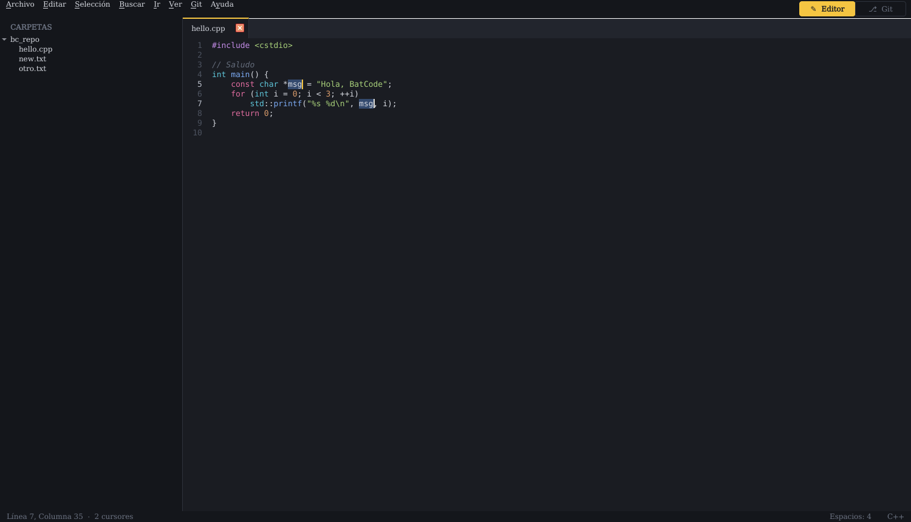
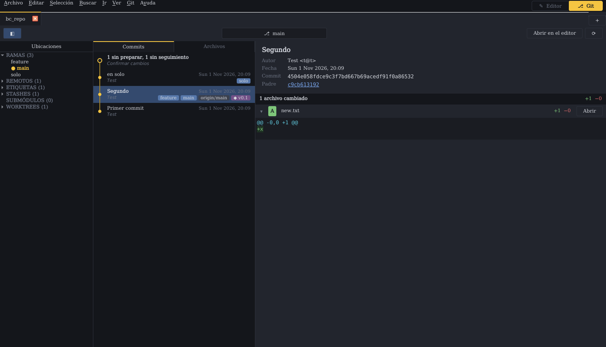

# 🦇 BatCode

Editor de texto en **C++17 + Qt 6** con **Git integrado (libgit2)**, para **Windows y Linux**.
Junta en una sola ventana lo que normalmente se hace con un editor de código y un cliente Git:
editar con cursores múltiples y, en el modo Git, revisar el historial y los diffs, preparar archivos y hacer commits.

> Todo el código es original. Las ideas de interfaz se tomaron del uso habitual de editores
> modernos, sin código ni recursos de ninguna otra aplicación.

BatCode tiene **dos modos**. Se cambia de uno a otro con el interruptor **[ ✎ Editor | ⎇ Git ]**
de la esquina superior derecha, o con `Ctrl+Shift+Tab` (alterna entre los dos).

| Modo editor | Modo Git |
|---|---|
|  |  |

## Idioma y preferencias

BatCode está disponible en **inglés** (idioma por defecto) y **español**. El idioma se cambia en
**File › Preferences…** (**Archivo › Preferencias…**, `Ctrl+,`). BatCode ofrece reiniciarse al
momento y conserva las carpetas, los archivos y los repositorios abiertos. Con el idioma también
cambian el formato de las fechas y, en español, los botones de los diálogos de Qt
(Aceptar/Cancelar/Guardar) y el menú de clic derecho del editor.

La ventana de Preferencias también permite elegir:

| Sección | Opción |
|---|---|
| General | Idioma: English / Español |
| Editor | Tamaño de fuente, sangría (espacios), ajuste de línea y números de línea |
| Git | La opción que ejecutan los botones Pull (`pull`, `--ff-only`, `--rebase`, `--rebase --autostash`) y Push (`push`, `--follow-tags`) |

**Cómo se traduce.** Los textos del código están en español (`tr("…")`), y la traducción al
inglés está compilada dentro del programa (`src/I18nTable.cpp`), así que no hacen falta archivos
`.qm` ni Qt Linguist. Si añades o cambias textos, ejecuta
`python tools/i18n/update_translations.py`: regenera la tabla y lista los textos que aún no tienen
traducción, que se añaden en `tools/i18n/translations_en.py`.

## Modo editor

Tiene dos partes: el **explorador de carpetas** a la izquierda (la carpeta abierta aparece como
nodo raíz bajo «CARPETAS»; se oculta y se muestra con `Ctrl+B`) y las **pestañas** con los
archivos abiertos.

- Pestañas que se pueden mover y cerrar, con el indicador ● de cambios sin guardar. Doble clic en
  la barra vacía crea un archivo nuevo.
- **Sacar una pestaña a otra ventana**, como en Sublime Text o VS Code: arrástrala y suéltala fuera
  de la ventana para abrirla en una ventana nueva, o suéltala sobre otra ventana de BatCode para
  moverla allí. Mientras la arrastras fuera, una vista previa semitransparente de la ventana nueva
  sigue al cursor. El clic derecho en la pestaña ofrece lo mismo: «Mover a una ventana nueva» y
  «Mover a la ventana …». La pestaña conserva sus cambios sin guardar, el cursor y el deshacer.
  Una ventana secundaria se cierra sola al quedarse sin pestañas y no guarda la sesión: al
  reabrir BatCode se restaura la sesión de la ventana principal.
- **Recarga automática**: si otro programa (u otro `git checkout`) cambia un archivo abierto y la
  pestaña no tiene cambios sin guardar, se recarga sola, conservando el cursor y el scroll; `Ctrl+Z`
  vuelve a la versión anterior. Si la pestaña tiene cambios sin guardar no se toca: solo aparece un
  aviso en la barra de estado. También se comprueba al volver a la ventana.
- Resaltado de sintaxis: C/C++, C#, Python, JavaScript/TypeScript, Rust, Go, JSON, CMake,
  Shell, YAML/TOML/INI, SQL, HTML/XML y Markdown.
- **Cursores múltiples**:
  - `Ctrl+Clic`: añade o quita un cursor
  - `Ctrl+D`: selecciona la palabra o añade la siguiente coincidencia
  - `Alt+F3`: selecciona todas las coincidencias
  - `Ctrl+Shift+L`: divide la selección en líneas
  - `Ctrl+Alt+↑/↓`: añade un cursor arriba o abajo
  - `Esc`: vuelve a un solo cursor
  - Copiar y pegar por cursor: si pegas N líneas con N cursores, cada uno recibe la suya.
- Autoindentación, `Tab`/`Shift+Tab` por bloques y retroceso inteligente dentro de la sangría.
- `Ctrl+/` comenta o descomenta, `Ctrl+Shift+D` duplica líneas.
- Buscar y reemplazar (`Ctrl+F` / `Ctrl+H`) con texto o regex, mayúsculas y palabra completa.
  En el reemplazo puedes usar grupos (`\1`). Con `Alt+Enter` pones un cursor en cada coincidencia.
- **Buscar en archivos** (`Ctrl+Shift+F`), como en Sublime Text:
  - Campos **Buscar**, **Donde** y **Reemplazar**, con historial.
  - Botones de opción: expresión regular (`.*`), mayúsculas (`Aa`), palabra completa,
    mostrar contexto, resultados en pestaña nueva, respetar `.gitignore` y conservar
    mayúsculas al reemplazar (`AB`).
  - **Donde** acepta una lista separada por comas: carpetas, archivos, filtros (`*.cpp`),
    exclusiones (`-*.log`, `-build`), `<open folders>` y `<open files>`. Vacío = carpetas
    abiertas (o archivos abiertos si no hay carpetas). El botón `…` ayuda a rellenarlo.
  - Los resultados se listan en una pestaña de solo lectura (`Buscando "x" en N archivos`),
    agrupados por archivo con número de línea, coincidencias resaltadas y líneas de contexto.
    **Doble clic** o **Enter** sobre una línea abre el archivo en esa línea con la coincidencia
    seleccionada; `F4` / `Shift+F4` saltan al resultado siguiente / anterior.
  - Se buscan también los cambios sin guardar de las pestañas abiertas; se omiten archivos
    binarios y la carpeta `.git`.
  - **Reemplazar** pide confirmación: en las pestañas abiertas el cambio se hace en el editor
    (se puede deshacer) y el resto de archivos se guarda en disco conservando CRLF/LF y BOM.
- **Clic central** (rueda del ratón) sobre una pestaña la cierra, igual que la ✕; también en las
  pestañas de repositorios del modo Git.
- **Minimapa** a la derecha (como en Sublime): el archivo en miniatura con sus colores y un
  recuadro con la parte visible. Un clic va a esa línea; arrastrar desplaza el editor.
  `Ctrl+Shift+M` (Ver › Mostrar minimapa) o Preferencias lo muestran u ocultan.
- `Ctrl+Shift+↑` / `Ctrl+Shift+↓`: mover la línea actual (o las seleccionadas) arriba / abajo.
- **Clic derecho en el panel de carpetas**:
  - Archivo: abrir, *Ejecutar* (`.bat`/`.cmd` en Windows, `.sh` en Linux; en una consola nueva que
    queda abierta), abrir la carpeta en el explorador con el archivo seleccionado, abrir una
    terminal en su carpeta, crear un archivo o una carpeta nuevos en su carpeta, renombrar (`F2`) y copiar la ruta.
  - Carpeta: **Nuevo archivo…**, **Nueva carpeta…** (también acepta subcarpetas, `assets/icons`), abrir una terminal ahí (Windows Terminal si está instalado, si no
    `cmd`), abrir en el explorador, renombrar (`F2`) y copiar la ruta.
  - Zona vacía del panel: **Nuevo archivo…** y **Nueva carpeta…** en la carpeta abierta.
  - Archivo o carpeta: **Eliminar…** (`Supr`) los mueve a la papelera, las carpetas con todo su
    contenido, tras confirmar. Funciona con varios elementos seleccionados y cierra las pestañas
    de los archivos borrados (avisa antes si alguna tiene cambios sin guardar). Si no hay
    papelera disponible, ofrece eliminarlos definitivamente.
  - *Nuevo archivo…* pide el nombre, crea el archivo vacío y lo abre en una pestaña. El nombre
    puede incluir subcarpetas (`src/util.cpp`), que se crean si no existen.
  - Al renombrar, las pestañas abiertas de ese archivo (o de los archivos de esa carpeta) se actualizan.
- **Arrastrar y soltar en el panel de carpetas**: arrastra archivos o carpetas (también varios con
  `Ctrl`/`Shift`) a otra carpeta del proyecto; si mantienes el ratón sobre una carpeta cerrada,
  se abre. Al soltar, un menú pregunta **Mover aquí**, **Copiar aquí** o **Cancelar**. Las copias
  en la misma carpeta se llaman «nombre - copia»; al mover, las pestañas abiertas siguen al archivo.
- `Ctrl` + rueda del ratón (o `Ctrl+=` / `Ctrl+-`): cambiar el tamaño de la fuente del editor;
  se aplica a todas las pestañas y se recuerda al reiniciar.
- `Ctrl+Tab` (o `Ctrl+AvPág`) / `Ctrl+RePág`: pestaña siguiente / anterior.
  En el modo Git cambian entre las pestañas de los repositorios abiertos.
- **Cierre automático** según el lenguaje: al escribir `(`, `[` o `{` se añade el cierre y el cursor
  queda dentro; también las comillas del lenguaje (en texto y Markdown solo `"` y `` ` ``, para no
  molestar con los apóstrofos). Con texto seleccionado lo envuelve; si escribes el cierre que ya está
  delante, se salta; `Backspace` entre una pareja vacía borra las dos; `Enter` entre `{}` deja el
  cursor en una línea sangrada. En HTML/XML, al escribir `>` de `<div>` se añade `</div>`.
  Se desactiva en Archivo › Preferencias.
- **Autocompletado de palabras**: al escribir 2 caracteres o más aparece una lista, en orden
  alfabético, con las palabras del proyecto abierto (se indexa en segundo plano), del archivo y del
  lenguaje que empiezan por lo escrito (`m_` → `m_boton`, `m_editor`, `m_menu`). Se actualiza con cada
  letra; `Tab` / `↓` pasan a la siguiente, `Shift+Tab` / `↑` a la anterior, `Enter` (o clic) la
  inserta y `Esc` la cierra. Se desactiva en Archivo › Preferencias.
- `Ctrl+P`: ir a archivo con búsqueda difusa. `Ctrl+G`: ir a línea.
- Barra de estado con línea y columna, número de cursores, sangría y lenguaje.
- Respeta los finales de línea CRLF/LF de cada archivo y guarda de forma atómica.

**Fuente:** se usan las mismas fuentes que Sublime Text trae por defecto en cada sistema:
**Consolas** en Windows, **Menlo** en macOS y **DejaVu Sans Mono** en Linux, a 10 pt
(`Ctrl+=` / `Ctrl+-` para cambiar el tamaño). En Windows, la interfaz usa Segoe UI 9 pt.

## Modo Git

Cada repositorio abierto es una **pestaña** (botón **+** para abrir otro). Al abrir una carpeta en
el modo editor, si es un repositorio, también se añade aquí. Cada repositorio tiene una barra
superior con la rama actual, «Abrir en terminal» (abre una terminal en la carpeta del
repositorio; también en el clic derecho de su pestaña), «Abrir en el editor» y «Actualizar» (`F5`), y **tres secciones**:

1. **Ubicaciones**: ramas, remotos, etiquetas, stashes, submódulos y worktrees, con su número.
   - Las ramas locales y remotas se ordenan y se agrupan en carpetas según el prefijo con `/`
     (`feature/login` aparece como `login` dentro de `feature`). La carpeta de la rama actual
     empieza desplegada, y el estado de cada carpeta se conserva al actualizar.
   - Clic en una rama, rama remota, etiqueta o stash: salta a su commit.
   - Doble clic en una rama local (o menú contextual): cambia a esa rama, con confirmación.
   - Al cambiar de rama (de cualquier forma) en un repositorio con **submódulos** inicializados,
     una ventana pregunta qué hacer con ellos:
     - **Cambiar también los submódulos**: los que tengan una rama con el mismo nombre cambian a
       ella (la local si existe, si no la del remoto con `--track`); el resto se queda como está.
     - **Solo el proyecto**: los submódulos se ponen en el commit que registra la rama de destino
       (`git submodule update --recursive`).

     Doble clic en la rama actual ofrece lo mismo sin cambiar de rama.
   - Doble clic en una rama remota (o menú contextual): si no existe en local, crea la rama local
     enlazada a la remota y cambia a ella (`git switch --track origin/<rama>`); si ya existe,
     cambia a la local.
   - Doble clic en un submódulo (o menú contextual): lo abre en una pestaña nueva, tal como esté
     (su rama o commit actual), y se usa como cualquier otro repositorio. Si aún no está
     descargado, ofrece `git submodule update --init`.
     El cambio es «seguro»: no sobrescribe cambios locales que entren en conflicto.
   - **Worktrees**: cada uno muestra la carpeta, la rama comprobada y el actual resaltado; iconos
     si está bloqueado o el directorio no es válido. Doble clic abre ese directorio en otra pestaña Git.
     Clic derecho en un worktree: abrir (pestaña Git, editor, explorador, terminal), eliminar,
     bloquear/desbloquear, reparar y podar. Clic derecho en el encabezado **WORKTREES**: añadir
     worktree (`git worktree add`), podar huérfanos y reparar todos.
   - Se oculta y se muestra con el botón ◧ de la barra.
2. **Commits / Archivos**
   - *Commits*: historial de todas las ramas (hasta 1000 commits) con el grafo de ramas (un
     carril de color por rama, curvas en las bifurcaciones y los merges, nodo hueco en los
     commits de merge), autor, fecha y etiquetas de ramas, remotos y tags. El primer elemento son los **cambios actuales**
     («2 sin preparar, 1 sin seguimiento · Confirmar cambios»). Su clic derecho ofrece
     **Preparar todo**, **Quitar todo de preparados** y **Descartar todos los cambios…**. Descartar
     todo pide confirmación: deja los archivos con seguimiento como en HEAD, manda a la papelera los
     archivos nuevos preparados y, si marcas la casilla, también los que no tienen seguimiento.
   - *Archivos*: los archivos del commit seleccionado o de los cambios actuales. Al hacer clic
     en uno, el detalle se desplaza a su diff.
3. **Detalle**
   - Para un commit: título, descripción, autor, fecha, SHA completo y padres (con enlace al
     padre), y el diff de cada archivo con `+añadidas −borradas`. Cada archivo se puede plegar.
   - Para los cambios actuales: mensaje del commit, tu identidad de Git y el botón **Commit**
     (o `Ctrl+Enter`), más las secciones **Archivos modificados**, **Archivos sin seguimiento** y
     **Archivos preparados** (en el mismo orden que Sublime Merge).
     Cada archivo tiene sus acciones (Preparar, Quitar, Descartar, Abrir) y cada sección tiene
     «Preparar todo» o «Quitar todo». Si un archivo tiene **varios bloques** de diff (`@@`),
     cada bloque muestra **Preparar bloque** / **Descartar bloque** (cambios sin preparar) o
     **Quitar bloque** / **Descartar bloque** (preparados), como en Sublime Merge.
   - Las secciones son **listas desplegables**: un clic en la cabecera (▼/▶), en el detalle o en la
     pestaña *Archivos*, la pliega o despliega. El **clic derecho en la cabecera** ofrece:
     - Modificados: preparar N archivos, descartar sus cambios, guardar parche…
     - Sin seguimiento: preparar N archivos, borrar N archivos (a la papelera).
     - Preparados: quitar N archivos de preparados, guardar parche…
     - Plegar/desplegar esta sección, desplegar todo y plegar todo.
     «Guardar parche…» escribe `git diff [--cached] --binary` en un `.patch` para `git apply`.

**Selección múltiple y menú contextual.** En la pestaña *Archivos* puedes seleccionar varios
archivos con `Ctrl+clic` y `Shift+clic`, incluso de secciones distintas. `Shift+Enter` prepara o
quita de preparados los seleccionados. El clic derecho, en la lista o sobre la cabecera de un
archivo en el detalle, ofrece:

| Opción | Qué hace |
|---|---|
| Preparar / Quitar de preparados (`Shift+Enter`) | Para todos los archivos seleccionados |
| Descartar cambios… | Vuelve a la versión preparada (pide confirmación) |
| Borrar archivo… | Mueve los archivos a la papelera |
| Historial del archivo | Commits de la rama actual que cambiaron el archivo; clic para abrir uno |
| Blame | Quién cambió cada línea y en qué commit; las líneas sin confirmar se marcan aparte; doble clic para ir al commit |
| Abrir en el editor… | Abre los archivos en el modo editor |
| Abrir carpeta contenedora… | Abre el Explorador con el archivo seleccionado |
| Copiar ruta del archivo / Copiar ruta relativa | Copia las rutas al portapapeles |

**Menú contextual de commits.** El clic derecho sobre un commit de la pestaña *Commits* lo
selecciona y ofrece:

| Opción | Qué hace |
|---|---|
| Checkout del commit… | `git checkout --detach`: HEAD queda desacoplado (pide confirmación) |
| Revert / Cherry-pick | `git revert --no-edit` / `git cherry-pick` (con `-m 1` en los merges). Cherry-pick se desactiva si el commit ya está en la rama actual |
| Copiar SHA / Copiar mensaje | Al portapapeles |
| Crear › Rama en este commit… | `git branch <nombre> <commit>` (sin cambiar de rama) |
| Crear › Etiqueta en este commit… | `git tag`; si escribes un mensaje, la etiqueta es anotada |
| Crear › Guardar parche… | `git format-patch -1 --stdout` en un `.patch` para `git am` |
| Editar › Editar mensaje del commit… | Cambia el mensaje de cualquier commit de la rama actual |
| Editar › Squash con el padre | Une el commit con su padre, conservando ambos mensajes |
| Editar › Mover arriba / Mover abajo | Intercambia el commit con el siguiente o con el anterior |
| Editar › Eliminar commit… | Quita el commit de la rama (pide confirmación) |
| Reset de «rama» a este commit › | `--soft` (conserva los cambios preparados), `--mixed` (sin preparar) o `--hard` (los descarta; pide confirmación) |

Las opciones de **Editar** reescriben el historial con `git rebase -i --autostash` sin pedirte
nada: BatCode actúa como editor de la lista de tareas del rebase. Solo están activas para commits
de la rama actual sin merges entre el commit y HEAD. Si el commit ya está en la rama remota,
avisa de que después hará falta un push forzado. Si el rebase se detiene por un conflicto,
resuélvelo y usa `rebase --continue` o `rebase --abort` desde la paleta de comandos.

**Operaciones remotas.** A la derecha de la barra del repositorio están **⇄ Merge**,
**⟲ Fetch**, **↓ Pull ▾**, **↑ Push ▾** y **⋯**. Pull y Push muestran cuántos commits hay por bajar
y por subir. Los botones ▾ abren una paleta con las opciones; se navega con ↑/↓, se filtra
escribiendo, Enter ejecuta y Esc cierra:

| Acción | Atajo | Opciones |
|---|---|---|
| Pull | `Ctrl+Alt+P` | — (usa la última opción elegida) |
| Opciones de pull | `Ctrl+Alt+Shift+P` | `pull`, `pull --ff-only`, `pull --rebase`, `pull --rebase --autostash`, `fetch`, `fetch --tags`, `fetch --prune`, `fetch --all` |
| Push | `Ctrl+Alt+U` | Si la rama aún no existe en el remoto, ofrece publicarla (`--set-upstream`) |
| Opciones de push | `Ctrl+Alt+Shift+U` | `push`, `push --set-upstream <remoto> <rama>`, `push --force-with-lease` (pide confirmación), `push --follow-tags`, `push --tags` |
| Fetch | `Ctrl+Alt+F` | — |
| Merge | `Ctrl+Alt+M` | Eliges la rama (local o remota) y luego `merge`, `merge --no-ff`, `merge --ff-only` o `merge --squash` |
| Comandos de Git | `Ctrl+Shift+P` | Lo anterior más cambiar de rama, crear rama, `stash`, `stash pop`, `merge --abort`, `rebase --continue`, `rebase --abort` y `fetch --all --prune` |

El clic derecho en las ubicaciones también permite fusionar una rama en la actual, hacer fetch
de un remoto concreto y, en las ramas locales, **renombrar** (`git branch -m`) y **eliminar**.
Eliminar usa `git branch -d` si la rama ya está en la rama actual; si tiene commits propios, avisa
de que dejarán de verse y usa `-D`. La rama actual no se puede eliminar. Estas operaciones usan **tu programa `git`**, así que funcionan con tus
credenciales de siempre (Git Credential Manager, claves SSH). Se ejecutan en segundo plano sin
abrir consolas, con una barra que muestra el progreso. Si algo falla, la barra se queda en rojo
con la línea del error y el botón «Ver salida».

La sesión recuerda el modo, la carpeta, los archivos y los repositorios abiertos.

## Compilar y ejecutar

Hay un script para compilar y otro para ejecutar en cada sistema:

| | Windows | Linux |
|---|---|---|
| Compilar | `build.bat` | `./build.sh` |
| Ejecutar | `run.bat` | `./run.sh` |

`run.bat` y `run.sh` compilan primero si el ejecutable no existe **o si cambiaste algo** en
`src/`, `CMakeLists.txt` o `vcpkg.json`, y después abren BatCode. Puedes pasarles archivos o una
carpeta para abrir: `run.bat F:\mi-proyecto`.

### Windows (`build.bat`)

Solo necesitas **Visual Studio 2022** con «Desarrollo para el escritorio con C++» y **Git**.
Se puede ejecutar con doble clic o desde una consola. El script hace todo lo demás:

1. Busca Visual Studio 2022 con `vswhere` y carga su compilador (MSVC x64). Si también tienes
   otra versión instalada, obliga a vcpkg a usar la misma.
2. Descarga **vcpkg** en `.deps\vcpkg` y compila **libgit2** (con pcre2), solo la primera vez.
3. Busca **Qt 6** en `QT_DIR`, en `C:\Qt\6.*\msvc2022_64` o en `.deps\Qt`. Si no lo
   encuentra, descarga Qt 6.8.3 con *aqtinstall* en `.deps\Qt` (unos 300 MB, una sola vez).
4. Configura y compila con CMake y Ninja en `build\windows`.
5. Copia junto a `BatCode.exe` las DLL de Qt (`windeployqt`) y las de libgit2.

Opciones: `build.bat Debug`, `build.bat --clean` (borra `build\windows` antes) y
`build.bat --no-pause`. Para usar tu propio Qt: `set QT_DIR=C:\Qt\6.8.3\msvc2022_64`.

La primera compilación tarda unos minutos (vcpkg y Qt); las siguientes solo recompilan lo que
cambió. Todo lo descargado queda en `.deps\` y `build\`, que Git ignora.

### Linux (`build.sh`)

Necesitas CMake, un compilador C++17, Qt 6 (Widgets) y libgit2. Si falta algo, el script te dice
qué instalar, o lo instala él con `./build.sh --install-deps`, que usa sudo y apt, dnf, pacman o
zypper según tu distribución. Equivale a:

```bash
# Ubuntu / Debian
sudo apt install build-essential cmake ninja-build pkg-config qt6-base-dev libgit2-dev libgl-dev
# Fedora
sudo dnf install gcc-c++ cmake ninja-build qt6-qtbase-devel libgit2-devel
# Arch
sudo pacman -S base-devel cmake ninja qt6-base libgit2
```

Opciones: `./build.sh debug`, `./build.sh --clean`, y `QT_DIR=~/Qt/6.8.3/gcc_64 ./build.sh` para
usar otro Qt. El ejecutable queda en `build/linux/BatCode`.

También puedes abrir la carpeta en Visual Studio, Qt Creator o CLion: todos entienden
`CMakeLists.txt`.

## Estructura

```
assets/                    Logo (logo.png), icono de Windows (logo.ico), recursos (batcode.qrc / batcode.rc) y lanzador de Linux (batcode.desktop)
src/
  main.cpp                 Punto de entrada y argumentos de línea de comandos
  MainWindow.*             Ventana, menús, cambio de modo, explorador de carpetas, pestañas y sesión
  ModeSwitch.*             Interruptor [Editor | Git] de la esquina superior derecha
  EditorTab.*              Pestaña = archivo + barra de búsqueda; carga y guardado
  CodeEditor.*             Editor: números de línea, cursores múltiples, sangría, búsqueda
  Minimap.*                Minimapa del editor (vista en miniatura y navegación)
  WordIndex.*              Índice de palabras del proyecto para el autocompletado
  FindBar.*                Barra de buscar y reemplazar
  FindInFiles.*            Motor de "Buscar en archivos": recorrido, búsqueda, reemplazo y formato de resultados
  FindInFilesPanel.*       Panel Buscar / Donde / Reemplazar (Ctrl+Shift+F)
  QuickOpenDialog.*        Ctrl+P con búsqueda difusa
  SyntaxHighlighter.*      Analizador léxico de resaltado (comentarios y cadenas multilínea)
  LanguageDefinitions.*    Palabras clave y reglas de cada lenguaje
  DiffHighlighter.*        Colores para diffs unificados
  GitRepository.*          Envoltorio RAII sobre libgit2: estado, diffs por archivo, stage,
                           commit, historial, ramas, remotos, tags, stashes, checkout
  CommitGraph.*            Distribución en carriles del grafo de commits
  RebaseHelper.*           Modo sin ventana que hace de editor de git en los rebases del menú de commits
  GitWorkspace.*           Modo Git: una pestaña por repositorio
  RepositoryView.*         Las tres secciones de un repositorio (ubicaciones, commits, detalle)
  FileDiffWidget.*         Bloque plegable con el diff de un archivo y sus acciones
  GitCommandPalette.*      Paleta emergente de comandos (opciones de pull, push, merge…)
  PreferencesDialog.*      Archivo › Preferencias (idioma, editor, Git)
  I18n.*, I18nTable.cpp    Idioma de la interfaz y tabla de traducciones (generada)
tools/i18n/                Script y textos para regenerar las traducciones
  Theme.*                  Paleta oscura y estilos
```

## Próximos pasos sugeridos

- Preparar cambios por bloque o por línea (*hunks*) desde la vista de diff.
- Diff lado a lado, números de línea en el diff y vista de *blame*.
- Resolver conflictos dentro de BatCode.
- Búsqueda en el historial.
- Paleta de comandos para el modo editor.
- Resaltado con tree-sitter, temas configurables y ajustes en JSON.
